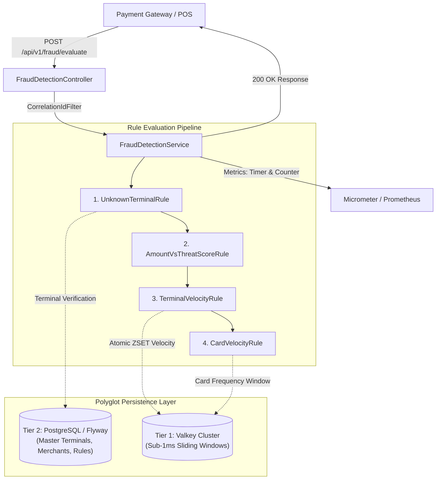

# Softpay Real-Time Fraud Detection Service

A production-grade, high-throughput, low-latency microservice designed for **Softpay** to evaluate inflight payment transactions in real time. Built with **Spring Boot 3.3**, **Java 21**, **Micrometer/Prometheus**, **OpenAPI (Swagger)**, and a **Polyglot Persistence Architecture** powered by **Valkey** and **PostgreSQL (Flyway)**.

The service executes an extensible, deterministic pipeline of fraud detection rules under strict sub-10ms latency budgets while adhering to PCI-DSS v4.0 security hygiene (zero raw PAN leakage, PAN masking, and salted SHA-256 tokenization).

---

## 1. Polyglot Persistence Architecture

To balance ultra-low latency with strong relational consistency, the service uses a **Polyglot Persistence Model**:



### Persistence Tiers:
1. **Tier 1 — High-Speed Distributed In-Memory Tier ([Valkey](https://valkey.io/)):**
   - Implemented via [`ValkeySlidingWindowRepository`](file:///Users/hakanbing/IdeaProjects/Fraud%20Detection%20Service/src/main/java/io/softpay/fraud/repository/ValkeySlidingWindowRepository.java).
   - Utilizes Redis-compatible **Sorted Sets (`ZSET`)** with epoch timestamps as scores.
   - Provides sub-millisecond execution ($< 1\text{ms}$) across scaled Kubernetes pods.
   - Automatic key expiration (`EXPIRE`) and rolling pruning (`ZREMRANGEBYSCORE`) eliminate memory leaks.

2. **Tier 2 — Relational Master Data Tier (PostgreSQL + [Flyway](https://flywaydb.org/)):**
   - Implemented via [`TerminalDataService`](file:///Users/hakanbing/IdeaProjects/Fraud%20Detection%20Service/src/main/java/io/softpay/fraud/repository/JpaTerminalRepository.java).
   - Schema versioning managed via Flyway (`V1__create_terminals_table.sql`).
   - Guarantees ACID compliance and durability for terminal configurations, merchant risk profiles, and audit journals.

---

## 2. Fraud Rules Catalogue & Decision Logic

1. **`UnknownTerminalRule` (Order 1)**
   - Validates whether `terminalId` exists and is `active` in `TerminalDataOut` (backed by PostgreSQL in production or In-Memory in dev/tests).
   - Unknown or suspended terminals immediately trigger a **hard rejection** (`score = 100`, `rejectionStatus = REJECTED`).

2. **`AmountVsThreatScoreRule` (Order 2)**
   - Normalizes incoming transaction amounts into base currency (`EUR`) via `CurrencyConversionService` (supports EUR, DKK, USD, GBP, SEK, NOK).
   - Computes dynamic maximum allowed limit based on terminal threat score:
     $$\text{MaxAllowedAmount} = \text{baseMaxAmount} \times \left(1 - \frac{\text{terminalThreatScore}}{100} \times 0.90\right)$$
   - If amount exceeds `MaxAllowedAmount`, generates rejection score (70–100).
   - If amount is within warning threshold ($\ge 70\%$ of limit), adds moderate warning score (25–50).

3. **`TerminalVelocityRule` (Order 3)**
   - Evaluates terminal transaction frequency within a rolling 60-second window in Valkey / In-Memory.
   - Dynamically scales allowed transaction count based on terminal threat score:
     $$\text{MaxTxInWindow} = \max\left(2, \text{round}\left(\text{baseMaxTxPerWindow} \times \left(1 - \frac{\text{terminalThreatScore}}{100} \times 0.80\right)\right)\right)$$
   - Rejects if transaction count meets or exceeds `MaxTxInWindow` (`score = 85`).

4. **`CardVelocityRule` (Order 4)**
   - Tracks card usage using a salted `SHA-256` hash in a rolling 60-second window in Valkey / In-Memory.
   - If card usage exceeds 3 transactions within 60 seconds, triggers hard rejection (`score = 90`).

### Decision Criteria
- **`REJECTED`**: Triggered if composite `fraudScore >= rejectionThreshold` (default `70`) OR any rule signals a `hardReject`.
- **`ALLOWED`**: Permitted when `fraudScore < 70` and no hard rejection occurred.

---

## 3. Quick Start & Execution

### Option A: Running with Docker Compose (Full Polyglot Stack: Valkey + PostgreSQL + App)
Spin up Valkey 8, PostgreSQL 16, and the Fraud Service with one command:
```bash
docker compose up --build -d
```
Verify containers are healthy:
```bash
docker compose ps
```

### Option B: Running Locally with Gradle
```bash
./gradlew bootRun
```

### Option C: Running Locally with Maven
```bash
mvn spring-boot:run
```

### Running Test Suites & JaCoCo Coverage
```bash
./gradlew clean test
```
All 10 test suites (including `ValkeySlidingWindowRepositoryTest` and `TerminalDataServiceTest`) run automatically with zero external dependencies using embedded in-memory stores. HTML reports are generated at:
- Unit & Integration Test Report: `build/reports/tests/test/index.html`
- JaCoCo Code Coverage Report: `build/reports/jacoco/test/html/index.html`

### Endpoints & Health
- **Swagger UI**: [http://localhost:8080/swagger-ui.html](http://localhost:8080/swagger-ui.html)
- **OpenAPI JSON**: [http://localhost:8080/v3/api-docs](http://localhost:8080/v3/api-docs)
- **Actuator Health**: [http://localhost:8080/actuator/health](http://localhost:8080/actuator/health)
- **Prometheus Metrics**: [http://localhost:8080/actuator/prometheus](http://localhost:8080/actuator/prometheus)

---

## 4. API Specification & Sample Curl Requests

### 1. Approved Transaction (`ALLOWED`, Score 0)
```bash
curl -X POST http://localhost:8080/api/v1/fraud/evaluate \
  -H "Content-Type: application/json" \
  -H "X-Correlation-ID: softpay-req-001" \
  -d '{
    "amount": 120.00,
    "currency": "EUR",
    "terminalId": "TERM-001",
    "terminalThreatScore": 10,
    "cardNumber": "4532015112831111"
  }'
```
**Response (`200 OK`):**
```json
{
  "rejectionStatus": "ALLOWED",
  "rejectionMessage": "Transaction approved",
  "fraudScore": 0,
  "rejected": false
}
```

### 2. Rejected Due to High Amount vs Terminal Threat Score (`REJECTED`)
```bash
curl -X POST http://localhost:8080/api/v1/fraud/evaluate \
  -H "Content-Type: application/json" \
  -H "X-Correlation-ID: softpay-req-002" \
  -d '{
    "amount": 3000.00,
    "currency": "EUR",
    "terminalId": "TERM-001",
    "terminalThreatScore": 60,
    "cardNumber": "4532015112831111"
  }'
```
**Response (`200 OK`):**
```json
{
  "rejectionStatus": "REJECTED",
  "rejectionMessage": "Amount exceeds allowed threshold for terminal threat score (amount: 3000.00 EUR, limit: 2300.00 EUR)",
  "fraudScore": 79,
  "rejected": true
}
```

### 3. Rejected Due to Card Velocity Breach (`REJECTED`)
```bash
curl -X POST http://localhost:8080/api/v1/fraud/evaluate \
  -H "Content-Type: application/json" \
  -d '{
    "amount": 25.00,
    "currency": "EUR",
    "terminalId": "TERM-001",
    "terminalThreatScore": 5,
    "cardNumber": "4532015112831111"
  }'
```
**Response (`200 OK`):**
```json
{
  "rejectionStatus": "REJECTED",
  "rejectionMessage": "Suspicious card usage frequency detected within time window",
  "fraudScore": 90,
  "rejected": true
}
```

### 4. Validation Error (`400 Bad Request` ProblemDetail)
```bash
curl -X POST http://localhost:8080/api/v1/fraud/evaluate \
  -H "Content-Type: application/json" \
  -d '{
    "amount": -50.00,
    "currency": "INVALID",
    "terminalId": "",
    "terminalThreatScore": 150,
    "cardNumber": "123"
  }'
```
**Response (`400 Bad Request`):**
```json
{
  "type": "https://softpay.io/errors/validation-failed",
  "title": "Validation Error",
  "status": 400,
  "detail": "Request validation failed",
  "errors": {
    "amount": "amount must be strictly positive",
    "currency": "currency must be a valid 3-letter ISO-4217 code",
    "terminalId": "terminalId is required",
    "terminalThreatScore": "terminalThreatScore must be between 0 and 100",
    "cardNumber": "cardNumber must be between 13 and 19 digits"
  },
  "correlationId": "8f2a1b94-d021-4f17-bb12-9c42a2f8914b",
  "timestamp": "2026-10-14T17:25:50.000Z"
}
```

---

## 5. Configuration Reference

| Property | Default Value | Description |
| :--- | :--- | :--- |
| `fraud.persistence.sliding-window` | `in-memory` (or `valkey`) | Sliding window store: `valkey` (distributed) or `in-memory` |
| `fraud.persistence.terminals` | `in-memory` (or `database`) | Terminal registry: `database` (PostgreSQL JPA) or `in-memory` |
| `fraud.rules.rejection-threshold` | `70` | Composite risk score threshold for rejection |
| `fraud.rules.salt` | `softpay-secure-production-salt-2026` | Secret salt used for SHA-256 PAN tokenization |
| `fraud.rules.amount-rule.base-max-amount-eur` | `5000.00` | Baseline maximum allowed transaction amount in EUR |
| `fraud.rules.amount-rule.threat-deduction-factor`| `0.90` | Factor scaling maximum amount based on threat score |
| `fraud.rules.amount-rule.warning-threshold-ratio`| `0.70` | Ratio of max limit triggering intermediate warning score |
| `fraud.rules.terminal-velocity-rule.window-seconds` | `60` | Sliding window duration for terminal velocity (seconds) |
| `fraud.rules.terminal-velocity-rule.base-max-tx-per-window` | `10` | Baseline max transactions allowed per terminal in window |
| `fraud.rules.terminal-velocity-rule.threat-deduction-factor` | `0.80` | Threat score reduction factor for terminal velocity |
| `fraud.rules.terminal-velocity-rule.min-allowed-tx` | `2` | Floor minimum allowed transactions for maximum threat |
| `fraud.rules.terminal-velocity-rule.score` | `85` | Fraud score applied on terminal velocity breach |
| `fraud.rules.card-velocity-rule.window-seconds` | `60` | Rolling window duration for card velocity (seconds) |
| `fraud.rules.card-velocity-rule.max-tx-per-window` | `3` | Max transactions permitted for a single card in window |
| `fraud.rules.card-velocity-rule.score` | `90` | Fraud score applied on card velocity breach |

---

## 6. Security Hygiene (PCI-DSS v4.0)

- **Zero Plaintext Logging**: Raw PAN numbers are never logged or stored. The `TransactionEvaluationRequest.toString()` method explicitly calls `CardSecurityUtils.maskPan(...)` (`453201******1111`).
- **Cryptographic Tokenization**: Card velocity tracking uses salted `SHA-256` digests, preventing rainbow table attacks against the finite PAN keyspace ($< 10^{16}$). Plain PANs are never written to Valkey.
- **Correlation ID Tracking**: All incoming requests receive or propagate an `X-Correlation-ID` header injected into the SLF4J MDC context for complete audit tracing.
